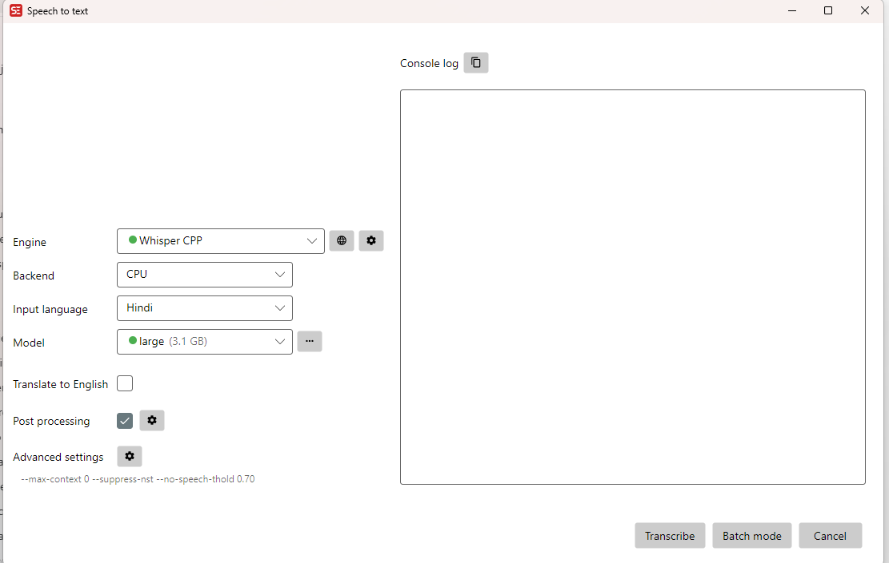

# Procédure JDownloader et Subtitle Edit

## 1. Préparer la vidéo

Cette procédure décrit la méthode déclarée par le créateur du projet. L'utilisateur a ensuite fourni la [vidéo YouTube de référence](https://www.youtube.com/watch?v=q6oDYStjuI4). Les métadonnées consultées le 12 octobre 2026 indiquent RKD Studios, une publication le 8 mai 2020 et une durée de 1 h 52 min 17 s. La date du téléchargement initial reste inconnue. L'identité octet pour octet de la vidéo locale n'a pas été vérifiée.

1. Vérifier que la copie et son utilisation sont autorisées; consulter [droits.md](droits.md).
2. Lancer JDownloader 2. Copier l'URL autorisée et la coller dans le collecteur de liens (« LinkGrabber » / « Ajouter des liens », selon la langue).
3. Examiner les variantes détectées. Choisir la version doublée en hindi, avec vidéo et audio, et un dossier local `media/`.
4. Démarrer le téléchargement sélectionné. Si JDownloader demande FFmpeg pour assembler les pistes, suivre sa proposition officielle. Ne pas contourner de protection ou de restriction d'accès.
5. Lire le fichier : contrôler langue parlée, début, fin, durée et présence du son. Noter URL, date, nom, durée et versions des logiciels dans une fiche de provenance de travail.

Le nom du fichier joint mentionne `1080p_25fps_H264-128kbit_AAC`. Il s'agit d'une indication du nom, pas de propriétés vidéo vérifiées : la vidéo n'a pas été fournie. Le SRT utilise des millisecondes; ne pas appliquer une conversion de cadence simplement à partir de ce nom.

## 2. Reproduire les réglages fournis

Ouvrir la vidéo dans Subtitle Edit, puis sa fonction de reconnaissance vocale (« Speech to text », généralement dans le menu Vidéo; l'emplacement varie selon la version).

| Champ visible | Valeur de la capture |
| --- | --- |
| Engine | `Whisper CPP` |
| Backend | `CPU` |
| Input language | `Hindi` |
| Model | `large (3.1 GB)` |
| Translate to English | Décoché |
| Post processing | Coché |
| Advanced settings | `--max-context 0 --suppress-nst --no-speech-thold 0.70` |

Reporter les options dans les réglages avancés du moteur compatibles avec la version utilisée. La capture ne montre ni la version de Subtitle Edit, ni celle de Whisper CPP, ni la variante précise de `large` (v1/v2/v3), ni les sous-options du post-traitement. On ne peut donc pas garantir une reproduction identique.

Ces options correspondent à une limite de contexte textuel de zéro, à la suppression des jetons non vocaux et à un seuil de non-parole de 0,70; vérifier leur disponibilité dans l'aide du moteur installé. Référence technique : [whisper.cpp](https://github.com/ggml-org/whisper.cpp). Conserver les journaux et le nom exact du modèle lors d'un nouvel essai.

Laisser la traduction anglaise désactivée pour obtenir une transcription hindi. Cette option n'effectue pas de traduction française. Lancer « Transcribe », attendre la fin, puis enregistrer en **SubRip (.srt), UTF-8** dans un nouveau fichier de travail. Ne jamais enregistrer par-dessus `subtitles/hi/original/prema-kavali.hi.v1.srt`.

## 3. Réviser avant de traduire

Une première correction textuelle existe déjà dans `subtitles/hi/revised/prema-kavali.hi.revised.srt`. Ne pas la remplacer par une copie de l'original. Charger cette version et la vidéo de référence dans Subtitle Edit. Afficher la forme d'onde si disponible, écouter chaque réplique et corriger le texte ainsi que ses entrées/sorties. Les corrections textuelles proposées doivent être examinées à l'écoute avant de les considérer comme définitives.

Commencer par les 17 blocs de durée nulle ou négative identifiés dans le [rapport](../reports/validation-hi-v1.md). Ne pas leur attribuer arbitrairement une durée : écouter la scène, fusionner ou retirer uniquement si justifié. Vérifier les répétitions, chansons, silences, noms propres et changements de locuteur avec une personne comprenant le hindi.

Exécuter le [validateur](validation.md), puis suivre le [guide de traduction](traduction-fr-CA.md). Une autre édition du film peut contenir des coupes ou un générique différent : une simple translation temporelle ne corrige pas nécessairement la synchronisation.

Références : [JDownloader](https://jdownloader.org/download/index), [documentation Subtitle Edit](https://subtitleedit.github.io/subtitleedit/).
